# Architecture

```mermaid
flowchart LR
    Coinbase["Coinbase Exchange BTC-USD"] --> Ingest["Bounded HTTP backfill"]
    Ingest --> Raw["Immutable raw responses and checkpoints"]
    Raw --> Data["Resolution-specific Parquet snapshots"]
    Data --> Feat["Completed bars and causal features"]
    Feat --> Setup["Independent hypothetical trade paths"]
    Setup --> Fit["Purged training and local model registry"]
    Setup --> Engine["VectorBT fractional ledger"]
    Fit --> Engine
    Engine --> Reports["Immutable per-profile run reports"]
    Reports --> UI["Read-only localhost dashboard"]
    Data --> UI
```

## Data and ownership

- Coinbase returns candle opening epoch seconds followed by low, high, open, close and volume. The client uses both UTC range bounds, at most 299 requested intervals to allow an inclusive endpoint candle, a single connection, a 260 ms request pause, and bounded exponential retries for transport errors and retryable HTTP statuses. It filters the response to the requested half-open interval. [Coinbase Exchange candle API](https://docs.cdp.coinbase.com/api-reference/exchange-api/rest-api/products/get-product-candles)
- Public Exchange REST requests have an IP limit. This downloader uses roughly four or fewer requests per second and is for backfill. [Coinbase Exchange REST rate limits](https://docs.cdp.coinbase.com/exchange/rest-api/rate-limits)
- Each range commits a raw response SHA-256, actual client receipt time, normalized Parquet fragment and request checkpoint. DuckDB consolidates with one thread and a 512 MB query memory limit. A conflicting timestamp blocks publication. Readers verify a snapshot SHA-256 and open its immutable file through the published pointer. The current checkpoint set and digest identify each publication.
- The ingestion store and the run/model store each have one OS-locked writer. A process crash releases the lock. Runs publish a manifest after their output files are complete. Streamlit reads snapshots and completed runs without starting jobs or altering accounts.
- UTC buckets open at midnight for days, at 00:00, 04:00, 08:00 and subsequent four-hour boundaries for 4h, and at Monday 00:00 for weeks. All buckets are left-closed and right-open. An aggregate requires every expected native bar. No candle is filled forward. Position and Swing use the native hourly feed. Day derives 15m, 1h and 4h directly from native five-minute observations.
- Feed reconciliation compares overlapping complete hours with absolute tolerances of USD 0.01 per OHLC field and 0.000001 BTC volume. The result is diagnostic. Each profile retains its original feed.
- Historical bars are treated as finalized at close. The processing allowance is added after a decision close. Original Coinbase publication timestamps are unknown.

## Strategy, features, and sizing

A baseline entry requires all completed context trend filters to pass and a decision close strictly above the maximum high of the preceding 20 decision bars. The fixed stop equals the decision close less twice 14-bar ATR. A decision close below the minimum low of the preceding 10 decision bars schedules a market exit. Current bars are excluded from both breakout ranges.

ATR is a simple rolling mean of true range. True range is the maximum of high minus low and the absolute high and low distances from the previous close. The first bar of a contiguous segment uses high minus low. The context SMA averages the trailing completed closes, including the last one. The EMA uses recursive weighting with alpha `2 / (span + 1)` and starts emitting after its full span. A context bar becomes eligible at its close, and an older context stops carrying once the next close should have occurred. Each series rebuilds its own warmup after a gap.

| Profile | Decisions | Completed context | Hold limit from fill |
| --- | --- | --- | --- |
| Spot / Position | 1D | Weekly close above its SMA20 | 30 elapsed days |
| Swing | 4h | Daily close above its SMA200 | 168 elapsed hours |
| Day | 15min | Hourly EMA20 above EMA50 and 4h close above EMA50 | Earlier of eight elapsed hours or 23:55 UTC |

The training features are close return over the configured decision lookback, ATR divided by close, close divided by the previous breakout high minus one, volume divided by the prior trailing mean minus one, and each context’s comparison divided by its reference minus one. Day also uses UTC hours remaining until the scheduled flat time at decision close. The warmup additionally requires the profile’s own momentum and prior-volume lookbacks. Each profile’s settings and full effective configuration hash identify its version.

The order planner sizes fractional BTC from the decision close as an estimated entry and applies the adverse price proxy and per-side fee to both the entry and the fixed stop. Quantity is bounded by 0.25% of available equity at the modeled stop, 25% entry notional and estimated cash. Filled quantity stays fixed. If the realized buy cost exceeds cash, the order is rejected in full. The journal measures notional and risk overruns from realized fills. The account holds one position, and price-driven exposure drifts.

## Execution and accounting

- A signal becomes actionable after its completed decision close plus the configured allowance, 30 seconds by default. Its order fills at the first execution candle open strictly later, plus any stress delay in whole bars. A 16:00 close therefore implies 17:00 hourly or 16:05 five-minute reference execution.
- Day evaluates the entry cutoff against the scheduled fill in the signal's UTC session. The first disallowed entry is 22:00 UTC. A known exit is attached at entry and released in time for the last execution open at or before the deadline, including the delay scenario. It can occur between decisions. A missing deadline bar leaves the position unresolved. Toronto time conversion is for display only.
- Protection is active immediately after the buy. An open at or below the stop exits at that open. Otherwise a low at or below the stop uses the stop as raw fill, with the adverse proxy applied to the execution price. The observed bar close is the resolution timestamp for an intrabar stop. If a known or signal exit executes at an open, that execution takes priority over later movement in that bar. A gap-through stop at the same open uses the same raw price. No stop is inferred across a missing candle.
- The planner determines causal order events and the VectorBT adapter submits explicit BTC amounts and adverse prices, with proportional fees and partial fills disabled. It uses ordered buy and sell slots so an entry-bar protective exit can be represented. The final engine cash reconciles against the planner. Candle-close drawdown measures observed marks, and can miss deeper intrabar drawdowns. [VectorBT explicit orders](https://vectorbt.dev/api/portfolio/base/)
- The reference uses a 50 bp fee and a 5 bp adverse proxy per side. Evaluation also covers every combination of 25, 50 and 80 bp fees with 5 and 10 bp proxies, plus one additional execution bar at reference cost. The reference model and zero threshold stay fixed.
- Cash earns zero. Full BTC and the passive 25% benchmark buy at the first evaluation open, allocating 100% or 25% of initial cash inclusive of entry fee. Both hold their original BTC quantity and mark through the account's last observed close. No ending liquidation is assumed. Each strategy also marks open positions at the boundary. If a gap occurs while open, the account and its benchmarks end at the last observable mark and the journal retains the unresolved position.
- Mean BTC weight is the average observed candle-close weight. Time exposure uses observed holding minutes divided by observed execution minutes. Intrabar exit time is conservatively assigned to its candle close. Turnover is total filled notional divided by mean marked equity.

Hand check used in the tests. A buy of 0.25 BTC at USD 100 and an entry-bar sale at USD 90, both with a 0.5% fee, debit USD 25.125 and credit USD 22.3875. Closing cash from USD 10,000 is USD 9,997.2625 with zero BTC. A separate fixture confirms a planned USD 25 stop loss including both adverse prices and fees when the actual entry matches the sizing estimate.

## Model and research windows

Every qualifying baseline setup is traced independently. Ineligible and unresolved cases retain a status, and resolved cases receive the net return on entry notional. Account occupancy, the model threshold, and the account’s cash balance have no effect on the hypothetical label. Labels and executed trades are separate files.

The frozen validation starts on 2025-01-01, evaluation starts on 2025-05-01 and the final holdout starts on 2025-11-08, all UTC. Training begins after profile-specific warmup. A training example must resolve strictly before the validation cutoff. The validation error uses outcomes resolved before the evaluation start, and the evaluation error uses outcomes resolved before the holdout. Each account replay ends at its own window boundary. The holdout lock is persisted and compared on each run.

StandardScaler and Ridge use one CPU worker and train only on eligible training rows. Ridge alpha is 1.0 and the reference filter accepts predicted net return greater than zero. The reports include outcome overlap counts and sample floors, which matter when nearby entries share much of the same future price path.

Normal model loading checks venue, instrument, market type, effective profile identity, decision frame, strategy/target/feature versions, execution hash, logic hash, and dependency versions. Frozen-model sensitivity explicitly permits alternate cost and delay settings and records them separately. Registry metadata links to a completed development report. All models in this build are unapproved and the holdout remains reserved.
