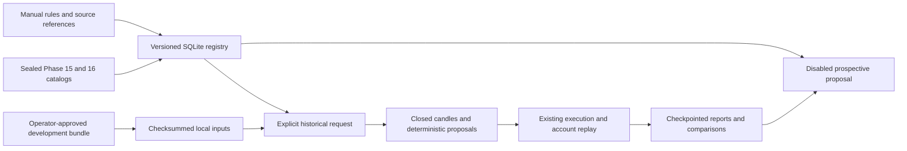

# Strategy Library and Research Lab

## Existing owners

- Phase 15 owns the registered KuCoin opportunities and four paper books. Its sealed registration supplies exact lane identities and settings. Its public worker and Telegram delivery keep their existing entry points.
- Phase 16 owns the challenger catalog, chronological folds, fitted artifacts and historical results. The initial sealed catalog binds KuCoin Spot and Binance futures development sources. The registry can index these as historical provenance. Binance evidence does not qualify as KuCoin XBTUSDTM data.
- Phases 14 and 17.1 own the amended KuCoin evidence and native learning allocations. The lab never opens those stores for experiment data. The legacy Coinbase collector and KuCoin native adapters continue to own acquisition.
- Shared feature and sizing code lives in `lab.learning`. Historical Spot execution uses its simulator. Futures execution uses the Phase 10 partition-aware simulator and historical account replay already used in Phase 16. The lab uses the existing shared research supervisor lock when running an experiment.

## Data flow

All new runtime state belongs under `runs/strategy_lab`. SQLite separates immutable strategy versions from append-only state history and immutable datasets and proposals. Jobs pin input hashes, code, chronological windows and fixed stress cases. The CLI runs one job at a time on demand. Streamlit queries metadata and completed results and supports explicit draft and proposal submissions.

The evaluator consumes a frozen recipe and causally available trade candles. Execution consumes its proposals and the separate modeled economic path. The historical lab offers a fixed IOC research policy for compatible strategies. Phase 15 publication, executable quote checks, expiry and book accounting retain their own policy. Unsupported inputs block admission, and unresolved economic paths produce inconclusive results.

The 15-minute native futures capture schedule is a collection cadence. Individual retained observations can be one-minute bars, with actual receipts later than their closes. Fast entry signals need a qualified availability contract and suitable historical resolution. An unavailable quote, tick, order book, or intrabar ordering has no implicit substitute.
